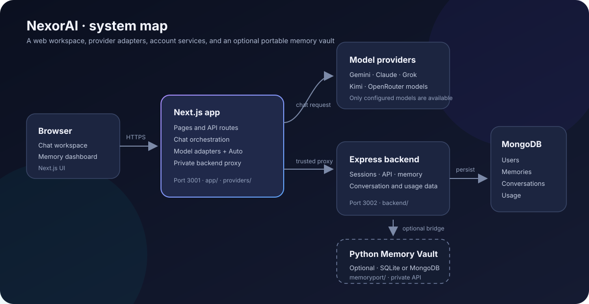
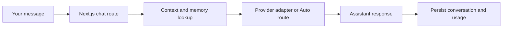

<div align="center">


# NexorAI

### One workspace for multiple AI models, conversations, and portable memory.

[Explore the code](#project-map) · [Run locally](#get-started) · [Understand the architecture](#how-it-fits-together) · [Find a guide](#choose-your-path)

</div>

NexorAI is a multi-provider AI workspace built with **Next.js**, an **Express** account and memory service, **MongoDB**, and an optional **Python Memory Vault**. Choose a model or let Auto routing select from configured providers, then manage saved conversations and user-controlled memory in one place.

> **Project status:** provider access depends on your own credentials. Some production features are still planned; see [current limitations](#current-limitations) before deploying publicly.

## ✨ What you can do

| Chat across providers | Route models locally | Keep useful context |
| --- | --- | --- |
| Select a configured model, use heuristic Auto routing, fallbacks, or compare responses. | Use the Python SDK's local rules, cost/latency settings, and adaptive feedback to pick models per chat. | Sign in, save conversations, and inspect or manage account-scoped memory. |

The workspace also includes a responsive chat UI, model availability metadata, a memory dashboard, privacy and terms pages, a first-party API reference, and an optional MCP bridge for Codex, Claude Code, and VS Code Copilot. The pip-installable Python package bundles MemoryPort's local portable fact vault, configurable vector embeddings and memory extraction, model routing, and multi-provider chat. Its default vault is shared across SDK chats and selected models on that device.

<a id="how-it-fits-together"></a>
## 🧭 How it fits together



The browser talks to the Next.js app. Its chat route calls the selected model adapter and uses a private proxy to reach the Express service for account sessions and saved data. MongoDB stores account and memory data. The Python Vault is optional: when configured, the backend can use it for fact recall and dashboard operations; conversation summaries and usage remain in MongoDB.

### A chat request, at a glance



<a id="get-started"></a>
## 🚀 Get started

### Requirements

- Node.js 20.9 or later and npm
- MongoDB for sign-in, saved conversations, and server-side memory
- Provider credentials for the models you want to use
- Python 3.10+ for the MemoryPort SDK or separate Memory Vault service

Install the frontend and backend dependencies:

```powershell
npm install
cd backend
npm install
cd ..
```

Create local environment files and add the MongoDB URI and any provider keys you want to use:

```powershell
Copy-Item .env.example .env
Copy-Item backend/.env.example backend/.env
```

Keep populated environment files private. Open two terminals from the repository root:

```powershell
# Terminal 1: Next.js app
npm run dev
```

```powershell
# Terminal 2: Express API
cd backend
npm run dev
```

Open [http://localhost:3001](http://localhost:3001). The API listens on port `3002` by default. Sign-in and server-backed memory features need a reachable MongoDB instance. Without provider credentials, those models are shown as unavailable.

### Start with Docker Compose

Compose starts the frontend, backend, and Python Memory Vault. MongoDB remains external. Create the environment files as above, set a reachable `MONGO_URI` and stable `SESSION_SECRET` in `backend/.env`, and replace the example `MEMORY_VAULT_API_TOKEN` with a random secret of at least 32 characters in `.env`.

```powershell
docker compose up --build
```

The Vault API stays on Compose's private network. Open [http://localhost:3001](http://localhost:3001); stop the stack with `Ctrl+C` or `docker compose down`. Compose does not migrate existing MongoDB memories into the Vault.

<a id="project-map"></a>
## 🗺️ Project map

| Path | What lives here | Start here |
| --- | --- | --- |
| [`app/`](app/README.md) | Next.js pages, API routes, chat orchestration, and UI styles | [`app/api/chat/route.ts`](app/api/chat/route.ts) |
| [`backend/`](backend/README.md) | Express routes, authentication, MongoDB models, and memory services | [`backend/server.js`](backend/server.js) |
| [`providers/`](providers/README.md) | Model registry, provider adapters, Auto routing, and fallbacks | [`providers/index.js`](providers/index.js) |
| [`memoryport/`](memoryport/README.md) | Python SDK, model router, temporal memory ledger, vault API, CLI, and optional MCP servers | [`memoryport/sdk.py`](memoryport/sdk.py) |
| [`nexorai/`](nexorai/__init__.py) | Short public Python import path for the SDK | [`nexorai/__init__.py`](nexorai/__init__.py) |
| [`components/`](components/legacy-page.tsx) · [`lib/`](lib/legacy-markup.ts) · [`public/`](public/) | Shared wrapper, legacy page markup, and browser assets/scripts | [`components/legacy-page.tsx`](components/legacy-page.tsx) |
| [`templates/`](templates/) · [`static/`](static/) | Legacy HTML templates and static assets | — |
| [`assets/`](assets/) | Project and provider artwork used by the UI and documentation | — |
| [`compose.yaml`](compose.yaml) · [`Dockerfile`](Dockerfile) · [`Dockerfile.vault`](Dockerfile.vault) | Local multi-service deployment and container builds | [Compose setup](#start-with-docker-compose) |
| [`.env.example`](.env.example) · [`backend/.env.example`](backend/.env.example) | Frontend/provider and backend configuration templates | [Configuration](#configuration-at-a-glance) |

<a id="choose-your-path"></a>
### Choose your path

- **Frontend contributor:** [routes, UI, and responsive styles](app/README.md)
- **API or data contributor:** [backend routes, sessions, and MongoDB](backend/README.md)
- **Model contributor:** [provider adapters and routing](providers/README.md)
- **Memory contributor:** [portable vault, CLI, API, and Python router](memoryport/README.md)
- **Memory feature reader:** [memory lifecycle and storage guide](app/memory/README.md)

<a id="configuration-at-a-glance"></a>
## ⚙️ Configuration at a glance

The root `.env` configures Next.js and model providers. `backend/.env` configures MongoDB and the Express service; the backend loads the root environment first, then lets backend values override it.

| Setting | Service | Purpose |
| --- | --- | --- |
| `GEMINI_API_KEY`, `CLAUDE_API_KEY`, `GROK_API_KEY`, `KIMI_API_KEY` | Frontend and/or backend | Enable the corresponding model features. |
| `OPEN_ROUTER_OPEN_API_KEYS`, `OPEN_ROUTER_API_KEY` | Frontend | Enable OpenRouter-backed models. |
| `MONGO_URI`, `MONGO_DATABASE`, `MEMORY_DATABASE` | Backend | Connect to account and memory databases. |
| `SESSION_SECRET` | Backend | Sign account sessions; use a stable high-entropy value in production. |
| `PROXY_TARGET` | Frontend | Backend URL; defaults to `http://localhost:3002`. |
| `MEMORY_VAULT_API_URL`, `MEMORY_VAULT_API_TOKEN` | Backend and Vault | Connect the trusted backend to the optional Vault API. |

See [`.env.example`](.env.example) and [`backend/.env.example`](backend/.env.example) for all options. Never commit real credentials or paste them into issues.

For semantic memory retrieval, create the Atlas Search vector index on `Memory.user_memories` using [`backend/memory-vector-index.json`](backend/memory-vector-index.json). The configured index expects 768-dimensional cosine vectors and filters for `userId` and `status`. Without the index or an embedding service, retrieval can use lexical and recency scoring.

<a id="current-limitations"></a>
## ⚠️ Current limitations

- Chat responses are not streamed.
- The frontend request limit is in-memory per frontend process, not a shared account quota.
- Public launch needs an account deletion and retention process, shared abuse controls, monitoring, backups, and deployment-specific security review.
- Model availability, IDs, prices, and provider behavior depend on external providers and your configuration.
- Auto routing uses task heuristics; it does not guarantee the best answer. The separate Python SmartRouter learns from feedback supplied by its integration.
- Cost figures are estimates only when operators configure per-model rates; they are not billing records.
- The Python Vault's working SQLite database is plaintext on disk. Encrypted `.nxvault` exports are available with the optional crypto extra.

Review the [Privacy Notice](app/privacy/page.tsx) and [Terms](app/terms/page.tsx) against your deployment and applicable provider agreements before release.

## 📚 More documentation

- [Frontend and mobile layout](app/README.md)
- [Backend, routes, and MongoDB](backend/README.md)
- [Memory layers, retrieval, and storage](app/memory/README.md)
- [Provider adapters, Auto routing, and costs](providers/README.md)
- [Python MemoryPort Vault and SmartRouter](memoryport/README.md)
- [Frontend scripts](package.json) · [Backend scripts](backend/package.json) · [Python package configuration](pyproject.toml)

## 🤝 Contributing

Start with the [contributor guide](CONTRIBUTING.md), choose the guide for the area you are changing, and pick a focused issue. Keep credentials and personal data out of commits and issue attachments.

